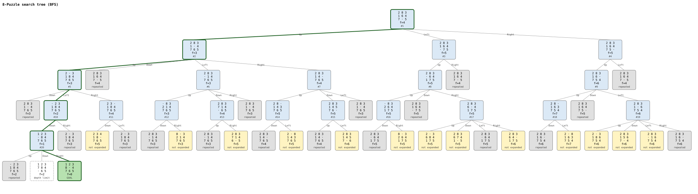
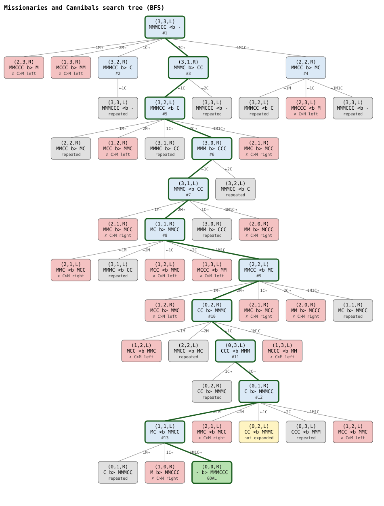
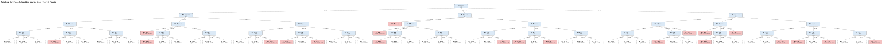

# Detyra 1 - Uninformed Search Techniques

Four search problems solved in Java 17 (no external libraries).

| # | Problem | Folder | Algorithm |
|---|---|---|---|
| 1 | Social Golfers | `1_social_golfers` | DFS with backtracking |
| 2 | Sudoku | `2_sudoku` | BFS with backtracking |
| 3 | Latin Square | `3_latin_square` | IDDFS and backtracking |
| 4 | Search Trees | `4_search_trees` | BFS / DFS on 8-Puzzle, Missionaries and Cannibals, Rotating Workforce |

## How to run

```
cd 1_social_golfers && javac SocialGolfers.java && java SocialGolfers
cd 2_sudoku         && javac SudokuBFS.java     && java SudokuBFS
cd 3_latin_square   && javac LatinSquare.java   && java LatinSquare 5
cd 4_search_trees   && javac *.java             && java EightPuzzle
```

Add `-h` to any program to see its options.

## 1. Social Golfers

32 golfers play once a week in 8 groups of 4. The goal is to find as many weeks as
possible where no two golfers are in the same group twice.

The program uses DFS with backtracking. With `--restarts` it finds 7 weeks in under
a second.

## 2. Sudoku

Solves Easy, Medium and Hard puzzles with BFS. Each step fills the cell with the
fewest possible values and drops grids that can't be completed.

```
java SudokuBFS --level hard
```

## 3. Latin Square

Fills an n × n grid with the numbers 1..n so that each number appears once in every
row and column. It can solve it with IDDFS or with plain backtracking.

```
java LatinSquare 5
java LatinSquare 30 --method backtracking
```

## 4. Search Trees

Draws the BFS or DFS search tree of a problem and saves it as an `.svg` picture.
The solution path is shown in bold.

**8-Puzzle:** slide the tiles to reach the goal board. BFS solves it in 5 moves.



**Missionaries and Cannibals:** get 3 missionaries and 3 cannibals across the river
without the cannibals outnumbering the missionaries on either side. BFS solves it in
11 crossings.



**Rotating Workforce:** build a weekly shift schedule (day, night, off) for 4
employees that covers every day and respects rest rules.


